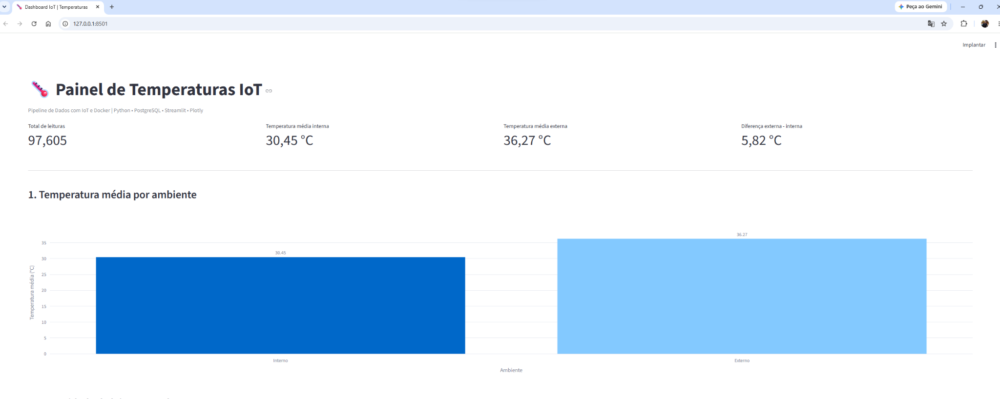
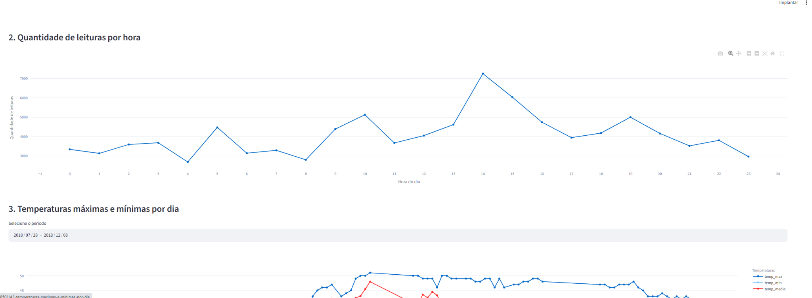
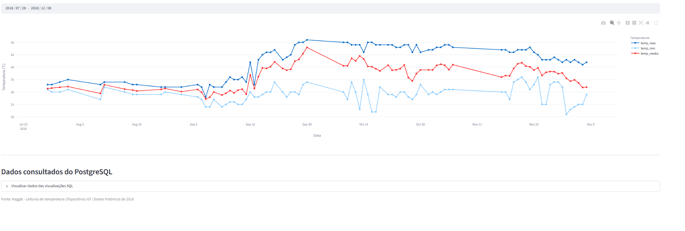

# 🌡️ Pipeline de Dados com IoT e Docker

Projeto acadêmico da disciplina **Disruptive Architectures: IoT, Big Data e IA**.

## 1. Sobre o projeto

Este projeto implementa um pipeline de dados para processar leituras de temperatura coletadas por dispositivos IoT.

Os dados são extraídos de um arquivo CSV disponibilizado no Kaggle, processados com Python e Pandas, armazenados em um banco PostgreSQL executado no Docker e visualizados em um dashboard interativo desenvolvido com Streamlit e Plotly.

O objetivo é demonstrar a integração das etapas de extração, transformação, carregamento e visualização de dados.

## 2. Tecnologias utilizadas

- Python 3.10
- Pandas
- SQLAlchemy
- Psycopg2
- PostgreSQL 17
- Docker e Docker Compose
- Streamlit
- Plotly
- Git e GitHub

## 3. Arquitetura do pipeline

```text
Kaggle - Dataset IoT
         |
         v
     Arquivo CSV
         |
         v
   Python + Pandas
  Limpeza e validação
         |
         v
 SQLAlchemy + Psycopg2
         |
         v
 PostgreSQL no Docker
         |
         v
     3 Views SQL
         |
         v
   Streamlit + Plotly
  Dashboard interativo
```

## 4. Estrutura de pastas

```text
pipeline-iot-docker/
├── data/
├── docs/
│   └── screenshots/
├── sql/
│   └── views.sql
├── src/
│   ├── pipeline.py
│   └── dashboard.py
├── .env.example
├── .gitignore
├── docker-compose.yml
├── requirements.txt
└── README.md
```

## 5. Base de dados

**Fonte:** Kaggle — Temperature Readings: IoT Devices

https://www.kaggle.com/datasets/atulanandjha/temperature-readings-iot-devices

O dataset original possui 97.606 registros e cinco colunas:

| Coluna original | Descrição |
|---|---|
| id | Identificador da leitura |
| room_id/id | Identificação do ambiente |
| noted_date | Data e horário da medição |
| temp | Temperatura registrada |
| out/in | Classificação interna ou externa |

Após a limpeza, uma duplicata completa foi removida, resultando em **97.605 registros válidos**.

Período dos dados: **28/07/2018 a 08/12/2018**.

O CSV não está incluído no repositório. Para executar o projeto, baixe o arquivo `IOT-temp.csv` no Kaggle e coloque-o na pasta `data/`.

## 6. Como executar o projeto

### Pré-requisitos

Instale Python, Git e Docker Desktop.

### Clonar o repositório

```bash
git clone https://github.com/crozbrow/pipeline-iot-docker.git
cd pipeline-iot-docker
```

### Criar ambiente virtual no Windows

```powershell
python -m venv venv
.\venv\Scripts\Activate.ps1
```

### Instalar dependências

```powershell
python -m pip install -r requirements.txt
```

### Configurar o ambiente

```powershell
Copy-Item .env.example .env
```

Edite `.env` e configure uma senha local para o PostgreSQL.

### Iniciar PostgreSQL no Docker

```powershell
docker compose up -d
docker compose ps
```

O banco utiliza a porta local **5433** para evitar conflitos com outros projetos.

### Executar o pipeline

```powershell
python src/pipeline.py
```

O script lê o CSV, valida as informações, converte as datas, elimina duplicatas completas e insere os dados no PostgreSQL.

A chave primária dos registros impede o armazenamento de identificadores duplicados.

### Criar as views SQL

```powershell
Get-Content sql\views.sql -Raw |
    docker exec -i postgres-iot psql -v ON_ERROR_STOP=1 -U iot_user -d iot_temperaturas
```

### Executar o dashboard

```powershell
python -m streamlit run src/dashboard.py
```

Acesse:

http://127.0.0.1:8501

## 7. Views SQL

### View 1 — avg_temp_por_ambiente

Calcula a temperatura média por classificação interna (`In`) e externa (`Out`), além da quantidade de leituras por categoria.

**Objetivo:** comparar as médias térmicas dos dois tipos de medição.

### View 2 — leituras_por_hora

Agrupa os registros pela hora do dia e contabiliza a quantidade de medições realizadas.

**Objetivo:** identificar horários de maior concentração de registros.

### View 3 — temp_max_min_por_dia

Calcula a temperatura máxima, mínima e média registrada em cada dia.

**Objetivo:** analisar as variações térmicas ao longo do período.

Todas as consultas estão disponíveis no arquivo `sql/views.sql`.

## 8. Dashboard interativo

O dashboard apresenta quatro indicadores principais e três gráficos:

1. Temperatura média por ambiente.
2. Quantidade de leituras por hora.
3. Temperaturas máximas, mínimas e médias por dia.

Também possui filtro de período e tabelas de consulta das views SQL.

### Capturas de tela

#### Temperatura média por ambiente



#### Quantidade de leituras por hora



#### Temperaturas máximas, mínimas e médias por dia



## 9. Resultados obtidos

| Indicador | Resultado |
|---|---:|
| Registros originais | 97.606 |
| Registros válidos | 97.605 |
| Duplicatas removidas | 1 |
| Leituras internas | 20.345 |
| Leituras externas | 77.260 |
| Temperatura média interna | 30,45 °C |
| Temperatura média externa | 36,27 °C |
| Diferença entre médias | 5,82 °C |
| Temperatura mínima geral | 21 °C |
| Temperatura máxima geral | 51 °C |
| Horário com mais registros | 14h |
| Leituras às 14h | 7.248 |

### Principais insights

A temperatura média externa foi superior à interna em 5,82 °C.

O horário das 14h apresentou a maior quantidade de registros. Essa concentração representa a frequência das medições, não necessariamente o horário de maior temperatura.

Os resultados demonstram como dados históricos de sensores podem apoiar análises de temperatura e o monitoramento ambiental.

Em aplicações reais, pipelines semelhantes podem auxiliar no controle de climatização, na identificação de anomalias e na geração de alertas.

## 10. Comandos Git utilizados

```bash
git init -b main
git status
git add .
git commit -m "Projeto inicial: Pipeline de Dados IoT"
git remote add origin URL_DO_REPOSITORIO
git push -u origin main
git pull
```

## 11. Segurança e persistência

As credenciais são configuradas através de variáveis de ambiente.

O arquivo `.env` é ignorado pelo Git para evitar a divulgação de senhas.

O PostgreSQL utiliza um volume Docker persistente para preservar os registros entre reinicializações.

Para interromper o banco sem excluir os dados:

```powershell
docker compose down
```

## 12. Limitações e melhorias futuras

O dataset possui apenas um ambiente identificado como `Room Admin` e não apresenta identificadores individuais de sensores.

As leituras são históricas, não representam monitoramento em tempo real.

Como melhorias futuras, o projeto pode incorporar MQTT, ingestão contínua, detecção de anomalias e alertas automáticos.

## 13. Conclusão

O projeto demonstrou a construção de um pipeline ETL funcional, integrando Python, Docker, PostgreSQL e Streamlit.

Foram processadas e armazenadas 97.605 leituras válidas, consultadas por três views SQL e apresentadas em gráficos interativos.

A solução demonstra como transformar dados brutos de sensores IoT em informações que podem apoiar decisões.
